 

 

## `~/projects`

<table>
<tr>
<td width="50%" valign="top">

**[telegram-gifts-parser](https://github.com/prezix/telegram-gifts-parser)** `Python`
 Floor-цены и история продаж Telegram Gifts в реальном времени.

</td>
<td width="50%" valign="top">

**[Telegram-Username-Toolkit](https://github.com/prezix/Telegram-Username-Toolkit)** `Python`
 Фильтрация, генерация вариантов и проверка доступности никнеймов.

</td>
</tr>
<tr>
<td width="50%" valign="top">

**[crackmes_lvl_1](https://github.com/prezix/crackmes_lvl_1)** `RE`
 Разбор лёгкого crackme и решение.

</td>
<td width="50%" valign="top">

**[cat-jpg-menu](https://github.com/prezix/cat-jpg-menu)** `GMod · CSS`
 Меню для Garry's Mod.

</td>
</tr>
<tr>
<td width="50%" valign="top">

**[Paiza-Progress-Tracker](https://github.com/prezix/Paiza-Progress-Tracker)** `JavaScript`
 Трекер прогресса на Paiza.

</td>
<td width="50%" valign="top">

**[Все репозитории →](https://github.com/prezix?tab=repositories)**
 Полный список на GitHub.

</td>
</tr>
</table>

 

## `~/site`

**[smelosti.net →](https://smelosti.net)**

 

## `~/watch`

  
  
  

 

<code>assets/terminal.svg</code> пересобирается сам раз в сутки из публичных данных GitHub · <a href="./scripts/build.py">как это работает</a>

